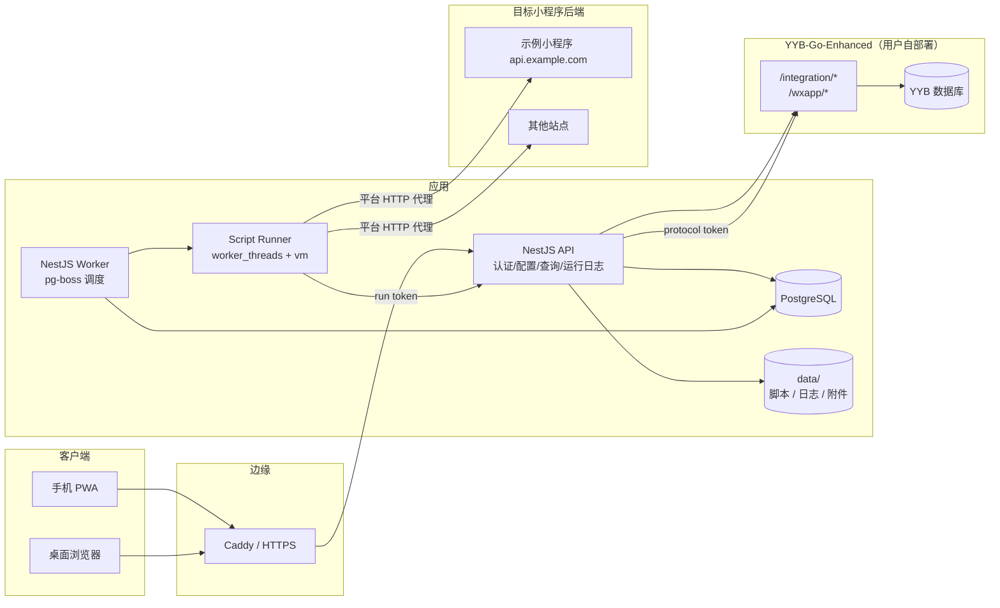

# 03 架构设计

## 1. 设计原则

1. **单实例自托管**：一个部署 = 一个管理员 + 自己的微信账号 + 自己的 YYB；不做多租户。
2. **开源可复制**：别人 clone 后能用自己的 YYB、自己的脚本源部署。
3. **脚本订阅制**：平台不鼓励任意上传；脚本从 GitHub 源同步，维护者审核，hash/版本可追溯。
4. **控制面与执行面分离**：API 管配置/查询；Worker 管调度/执行；脚本在 worker 的隔离上下文中跑。
5. **PostgreSQL 单一事实源**：业务数据、任务队列、运行记录元数据都进库；大日志放磁盘。
6. **PC 优先、移动端友好**：Vue 3 + Tailwind，桌面侧边栏/多列，手机响应式卡片/底部导航。
7. **安全边界说清楚**：Node `vm` 不是安全沙箱；官方源靠审核，custom 禁用 `dependencies/require`，再加最小注入 + 网络代理。

## 2. 技术栈

| 层 | 选型 | 说明 |
| --- | --- | --- |
| 前端 | **Vue 3 + TypeScript + Vite + TailwindCSS + reka-ui/shadcn-vue + Pinia + TanStack Query** | 移动优先；Tailwind 自定义设计；PWA |
| 后端 | **NestJS 11 + Fastify + Prisma + PostgreSQL 16 + pg-boss** | TypeScript 全栈；模块化；Swagger |
| 校验 | **Zod + nestjs-zod**（或 class-validator） | 前后端共享 schema |
| 队列/调度 | **pg-boss** | PostgreSQL 队列，无需 Redis；支持 cron、重试、优先级、单例 |
| 脚本编译 | **esbuild** | TS/JS -> 单文件 bundle，注入 SDK |
| 脚本运行时 | **Node.js 22 `worker_threads` + `vm`** | 资源限制、超时、上下文隔离；仅运行可信脚本 |
| 反向代理 | **Caddy 2** | 自动 HTTPS；ARM64 支持 |
| 部署 | **Docker Compose** | ARM64/amd64；NAS/服务器 |
| 通知 | **Server酱**（首期） | 后续 PushPlus/企业微信/Telegram |

### 2.1 为什么用 NestJS

- 你已选择 NestJS + Vue3 + Tailwind，前后端同语言，类型/Zod schema 可共享。
- NestJS 的模块/Guard/Interceptor 适合做认证、审计、限流、日志。
- `pg-boss` 与 NestJS 生命周期集成简单；无需额外 Redis。
- Prisma 的 schema/migrations 对单体项目足够；复杂 SQL 可用 `$queryRaw`。

### 2.2 为什么用 PostgreSQL + pg-boss

- 任务、运行记录、积分流水、商品快照都适合关系型 + JSONB。
- `pg-boss` 用 Postgres 做队列，少一个 Redis 容器；适合 NAS。
- 事务和业务数据同库，减少“任务成功但业务没写”的不一致。
- 后续要更高吞吐，可换 BullMQ/Redis/NATS，业务表不变。

### 2.3 为什么 Node worker/vm

- 你选择的脚本形态是 JS/TS，Node 原生执行，生态最顺。
- `worker_threads` 可以限制内存、超时、终止；`vm` 提供独立全局上下文。
- **注意**：`vm` 不是安全边界，无法抵御恶意逃逸；官方源靠审核，自定义源禁用 `dependencies/require`，只用 `ctx` API。
- 后续可加：Node `--experimental-permission`、Deno 子进程、容器沙箱。

## 3. 组件图



## 4. 运行流程

### 4.1 账号同步

```text
定时/手动
  -> API GET YYB /integration/accounts
  -> upsert wechat_accounts
  -> 状态变化通知（失效/恢复）
```

### 4.2 任务执行

```text
pg-boss cron / 手动触发
  -> 创建 job（task + scheduled_for + idempotency_key）
  -> Worker 领取
  -> 创建 run，生成 run_token
  -> esbuild bundle 脚本（缓存）
  -> 启动 worker_thread + vm context
  -> 注入 ctx（yyb/http/session/log/sleep）
  -> 脚本执行 login/sign_in/points
  -> 平台代理请求 YYB / 目标站点
  -> 写 result，更新积分/商品/活动
  -> 发 Server酱 通知
```

### 4.3 脚本订阅

```text
GitHub 脚本仓库
  -> CI 校验 manifest/测试/敏感信息
  -> 生成 index.json（版本、hash、能力、审核状态）
  -> 平台 GET index.json
  -> 用户选择安装/更新
  -> 下载 bundle，校验 SHA-256
  -> 存 script_versions
  -> 绑定账号，创建任务
```

## 5. 脚本订阅设计

### 5.1 脚本仓库结构

建议脚本放在**独立仓库** `free-welfare-scripts`，这样平台和脚本可以各自发布、各自 CI；如果早期想省事，也可以先放在本仓库 `scripts/` 下，后续再拆。

```text
free-welfare-scripts/
  packages/common/          # 全局公共
  index.json
  scripts/
    demo/
      common/               # 应用公共（登录/加密/session）
      login/                # 一功能一脚本
      sign-in/
      points/
      products/
      activities/
```

`index.json` 示例：

```json
{
  "schema_version": 1,
  "generated_at": "2026-11-13T00:00:00Z",
  "scripts": [
    {
      "id": "demo.sign_in",
      "name": "每日签到",
      "version": "0.1.0",
      "kind": "action",
      "capability": "sign_in",
      "platform": "wechat_miniprogram",
      "app_id": "wx0000000000000000",
      "common_version": "0.1.0",
      "review_status": "reviewed",
      "bundle_url": "https://raw.githubusercontent.com/.../demo-sign-in-0.1.0.js",
      "sha256": "...",
      "min_platform_version": "0.1.0"
    }
  ]
}
```

### 5.2 审核与信任

- 所有脚本 PR 需要维护者审核：接口来源、权限、敏感信息、幂等性、错误处理。
- CI：manifest schema、TypeScript 编译、单测、禁止 `fs/child_process/net/http` 等危险内置模块、禁止硬编码 token。
- `review_status`：`reviewed` / `community` / `custom`。
- 平台默认只显示 `reviewed`；`community` 需用户确认；`custom` 明确警告。
- 版本固定 + hash 校验；更新前显示 changelog。

### 5.3 自定义源

- 用户可以添加自己的 GitHub 源（公开/私有 token）。
- 自定义源脚本标记 `custom`，不享受官方审核背书。
- 首期支持自定义源，但 `custom` 脚本**不允许 `dependencies/require`**，只能用 `ctx` API；UI 强警告，用户自己判断风险。
- 需要依赖的脚本请提交官方源审核；未来要运行不可信依赖，需 Deno/容器隔离。

## 6. 脚本运行时

### 6.1 执行单元

- 一次运行 = 一个账号 + 一个站点 + 一个能力。
- 平台不把多个账号塞进一个脚本；账号循环由平台调度。
- 这样缓存、日志、失败隔离、并发控制都清晰。

### 6.2 注入上下文

脚本只能看到：

```ts
ctx.yyb.getCode()          // 平台代理 YYB
ctx.yyb.getPhoneNumber()   // 可选
ctx.http.post/get(...)     // 平台 HTTP 代理，域名白名单
ctx.session.get/set(...)   // 加密 KV
ctx.log.info/warn/error    // 结构化日志
ctx.sleep(ms)              // 受超时限制
ctx.time.now()             // 时间
ctx.runId / ctx.dryRun
```

不注入：

- 真实 `process`、`fs`、`child_process`；`require` 是受控包装（custom 禁用）
- 宿主机环境变量
- YYB 协议令牌、数据库连接、其他账号数据
- 直接 `fetch`（网络走 `ctx.http` 代理）

### 6.3 资源限制

- `worker_threads` 的 `resourceLimits`：老生代/新生代内存上限。
- 超时：默认 120s，可按脚本配置；超时 `worker.terminate()`。
- 输出上限：stdout/stderr/日志总量限制，防止刷爆磁盘。
- 临时目录：每次运行独立，结束清理；只允许 `data/artifacts/<run>` 写入。
- 并发：每账号串行；全局 worker 并发可配。

### 6.4 运行协议

```text
worker 启动
  -> 读取 bundle + input.json + run_token
  -> 创建 vm context
  -> 执行 bundle，调用 adapter[capability](ctx)
  -> 输出 result.json（ok/error_code/message/metrics/data）
  -> worker 退出码 0/2/3/4/5/124
```

错误码见 [05 脚本系统](05-script-system.md)。

## 7. YYB 集成

### 7.1 连接方式

每个使用者部署自己的 YYB：

```env
YYB_BASE_URL=http://yyb-go:8000
YYB_INTEGRATION_TOKEN=...
YYB_PROTOCOL_TOKEN=...
```

- 同 Docker 网络：`http://yyb-go:8000`。
- 不同机器：HTTPS/内网地址；确保只允许平台访问。
- 平台不直接读 YYB 数据库。

### 7.2 平台代理

```text
脚本 ctx.yyb.getCode()
  -> Worker 内部调用 API /internal/runner/yyb/get-code
  -> API 校验 run_token（账号/站点/能力）
  -> API 调 YYB /integration/actions/get-code
  -> 返回 code
```

手机号/`operateWxData`：

```text
API /internal/runner/yyb/phone
  -> YYB /wxapp/getPhoneNumber（protocol token）
```

### 7.3 旧脚本兼容（可选）

如果以后要复用青龙脚本：

```text
YYB_SERVER=http://api:3000/runner/yyb/<run_token>@1
YYB_API_KEY=<run_token>
```

平台代理 `/runner/yyb/<token>/wxapp/getCode`，校验后转发。首期不做，Phase 3 视需要加。

## 8. 部署（ARM64 NAS）

```text
Internet / LAN
      │
 ┌────▼────┐
 │ Caddy   │ 80/443
 └────┬────┘
      │
 ┌────┴──────────────┐
 │                   │
┌▼─────────┐   ┌─────▼─────┐
│ API      │   │ Worker    │
│ :3000    │   │           │
└────┬─────┘   └─────┬─────┘
     │               │
     └───────┬───────┘
        ┌────▼─────┐
        │PostgreSQL│
        └──────────┘
        ┌──────────┐
        │ YYB(可选)│
        └──────────┘
```

Docker Compose 服务：

| 服务 | 说明 |
| --- | --- |
| `caddy` | 反向代理/HTTPS；只暴露 80/443 |
| `api` | NestJS API + 静态前端 |
| `worker` | NestJS standalone + pg-boss + script runner |
| `postgres` | PostgreSQL 16；持久化卷 |
| `yyb-go` | 可选；也可用外部 YYB |

镜像：

- `node:22-bookworm-slim`（ARM64/amd64 多架构）。
- `postgres:16-alpine`。
- `caddy:2-alpine`。
- 构建 `linux/arm64` 与 `linux/amd64`。

资源建议：

- 最低 2GB RAM（Postgres + API + Worker）。
- 推荐 4GB RAM，特别是多个账号/脚本并发时。
- 磁盘：日志/附件/脚本版本会增长，预留 5-10GB。

卷：

- `pgdata`
- `./data/scripts`
- `./data/logs`
- `./data/artifacts`
- `./data/uploads`（临时）

启动顺序：

1. `postgres` 健康。
2. `api` 运行 Prisma migrate + pg-boss schema 初始化。
3. `worker` 启动，注册队列。
4. `caddy` 反代 `api:3000`。

## 9. 安全设计

### 9.1 认证

- 首次启动创建管理员；之后关闭注册。
- 用户名 + Argon2id 密码。
- 会话：httpOnly/Secure/SameSite=Lax Cookie + 服务端 session 表；或短 JWT + refresh token 轮换。
- 可选 TOTP。
- 登录失败限流；默认只允许内网/VPN 访问，公网必须 HTTPS + 强密码。

### 9.2 密钥

- `APP_ENCRYPTION_KEY`（32 bytes base64）加密：YYB token、Server酱 token、脚本配置里的手机号/密码。
- 主密钥只从环境变量/secret 文件读取，不写库、不写日志。
- 日志脱敏：`code/sid/token/cookie/authorization/phone/openid`。
- 前端只显示“已配置”，不回显完整密钥。

### 9.3 脚本供应链

- 只默认显示 `reviewed` 脚本。
- 安装/更新校验 SHA-256；版本可回滚。
- 脚本禁止硬编码敏感信息；CI 检查。
- 自定义源标记风险；`custom` 脚本禁用 `dependencies/require`，只用 `ctx` API。
- 运行日志保留脚本版本/hash，方便定位“更新后开始失败”。

### 9.4 网络

- YYB 不暴露公网；平台与 YYB 同内网。
- 脚本 HTTP 走平台代理：应用级 `network_mode` + `allowed_origins`，脚本 manifest `allowed_domains` 只能缩小；详见 [12 网络策略](12-network-policy.md)。
- 代理层做 SSRF 防护：禁止内网 IP、localhost、元数据地址、非 80/443 端口（可配置）。
- 出站可配代理（按账号/全局）。

### 9.5 备份

- 每日 `pg_dump` + `data/` 备份；保留 7/30 天。
- 恢复演练：新容器导入 DB + 脚本目录，验证账号/任务/运行。
- 升级前备份；Prisma 迁移尽量向后兼容。

## 10. 可观测性

- **运行记录**：状态、耗时、退出码、错误码、积分前后变化。
- **日志**：JSON lines；按 run 存文件；DB 存元数据；SSE tail。
- **指标**（后续）：任务成功率、平均耗时、YYB 取码次数/429/409、积分赚取/消耗。
- **告警**：账号失效、连续失败、验证码待处理、积分即将过期、脚本更新、磁盘不足。
- **审计**：脚本安装/更新/回滚、配置修改、账号绑定、任务启停。

## 11. 扩展路径

| 阶段 | 变化 |
| --- | --- |
| MVP | 单管理员 + 1 个订阅源 + 首个应用脚本 + 签到/积分 |
| Phase 2 | 商品/活动、积分批次、脚本更新/回滚、更多脚本 |
| Phase 3 | 兑换/抢购、旧脚本兼容、自定义源增强（依赖/隔离） |
| Phase 4 | 可选 Deno/容器沙箱、多用户/家庭共享、更多平台 |
