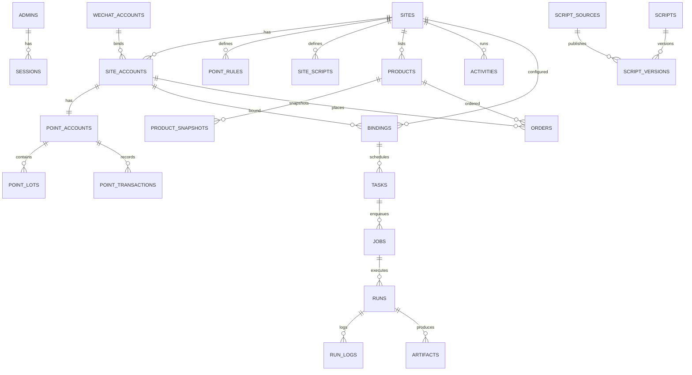

# 04 领域模型与数据模型

> 自托管单实例，不做多租户。ID 用 `BIGINT GENERATED ALWAYS AS IDENTITY`；时间存 `timestamptz`，UTC，界面按本地时区显示。数据库 PostgreSQL 16。

## 1. 领域关系



## 2. 核心实体

### 2.1 `admins`

首期只有一个管理员；保留表结构，后续可加只读成员。

| 字段 | 类型 | 说明 |
| --- | --- | --- |
| `id` | bigint PK | |
| `username` | text unique | 登录名 |
| `password_hash` | text | Argon2id |
| `totp_secret_enc` | bytea null | 可选 TOTP |
| `disabled` | boolean | |
| `created_at` / `updated_at` | timestamptz | |

### 2.2 `sessions`

| 字段 | 类型 | 说明 |
| --- | --- | --- |
| `id` | bigint PK | |
| `admin_id` | bigint FK | |
| `token_hash` | text unique | 只存 hash |
| `expires_at` | timestamptz | |
| `ip` / `user_agent` | text | |
| `created_at` | timestamptz | |

### 2.3 `wechat_accounts`

从 YYB 同步的微信账号。平台不保存微信登录凭据。

| 字段 | 类型 | 说明 |
| --- | --- | --- |
| `id` | bigint PK | |
| `yyb_ref` | text unique | YYB 账号 ID（主账号） |
| `display_name` | text | 备注/昵称 |
| `remark` | text | YYB 备注 |
| `status` | text | `alive/session_only/unknown/expired/disabled` |
| `scan_product` | text | `yyb/pcmgr/gameassist/...` |
| `openid_masked` | text | 脱敏 OpenID |
| `avatar_url` | text | |
| `last_synced_at` | timestamptz | |
| `raw` | jsonb | YYB 返回的脱敏元数据 |
| `created_at` / `updated_at` | timestamptz | |

### 2.4 `sites`

一个目标小程序/平台。

| 字段 | 类型 | 说明 |
| --- | --- | --- |
| `id` | bigint PK | |
| `key` | text unique | 内部标识，如 `demo` |
| `name` | text | 展示名 |
| `platform` | text | 首期 `wechat_miniprogram` |
| `app_id` | text | 小程序 AppID；同平台唯一 |
| `icon_url` | text | 在线 http(s) URL，或应用目录内的相对路径（如 `icons/icon.png`） |
| `description` | text | |
| `points_name` | text | 积分的应用内名称，默认 `积分`；各应用可自定义 |
| `capabilities` | text[] | 由应用脚本声明的能力汇总（只读/派生） |
| `script_mode` | text | `platform` / `qinglong` |
| `config` | jsonb | 应用级配置，脚本通过 `ctx.app.config` 读取 |
| `network_mode` | text | `whitelist` / `unrestricted` |
| `root_urls` | jsonb | 根 URL 列表（id/url/purpose/path_prefix/used_by/required）；UI 只需填写 url，其余可选 |
| `allowed_origins` | text[] | 脚本白名单 origin |
| `network_notes` | text | 备注 |
| `status` | text | `active/disabled/broken` |
| `metadata` | jsonb | 主体、官网、备注 |
| `created_at` / `updated_at` | timestamptz | |

唯一约束：`(platform, app_id)`。

### 2.5 `site_accounts`

“微信账号 + 站点”的业务身份。

| 字段 | 类型 | 说明 |
| --- | --- | --- |
| `id` | bigint PK | |
| `site_id` | bigint FK | |
| `wechat_account_id` | bigint FK | |
| `business_user_id` | text null | 站点 user_id/member_id |
| `nickname` | text | 站点内昵称 |
| `session_enc` | bytea/jsonb | 加密后的业务 token/sid/cookie |
| `session_expires_at` | timestamptz null | |
| `status` | text | `active/login_required/phone_required/registered/disabled/error` |
| `disabled` | boolean | 是否停止该绑定账号的自动运行；手动刷新仍可执行 |
| `last_login_at` | timestamptz | |
| `last_error` | text | 脱敏 |
| `raw` | jsonb | 站点资料 |
| `created_at` / `updated_at` | timestamptz | |

唯一约束：`(site_id, wechat_account_id)`。

### 2.6 `point_accounts`

| 字段 | 类型 | 说明 |
| --- | --- | --- |
| `id` | bigint PK | |
| `site_account_id` | bigint FK unique | |
| `balance` | bigint | 当前余额（如积分/金币） |
| `currency` | text | 默认 `points`；可 `fubi` |
| `expiring_amount` | bigint | 即将过期汇总 |
| `next_expiry_at` | timestamptz null | |
| `rules_text` | text | 积分规则原文/摘要 |
| `estimated` | boolean | 是否估算 |
| `last_synced_at` | timestamptz | |
| `raw` | jsonb | 原始响应（脱敏） |

### 2.7 `point_lots`

积分批次，解决“什么时候过期”。

| 字段 | 类型 | 说明 |
| --- | --- | --- |
| `id` | bigint PK | |
| `point_account_id` | bigint FK | |
| `amount` | bigint | 发放金额 |
| `remaining` | bigint | 剩余可用 |
| `granted_at` | timestamptz | |
| `expires_at` | timestamptz null | null=永久 |
| `source` | text | `sign_in/activity/order/refund/manual` |
| `source_ref` | text | 活动/订单/流水号 |
| `estimated` | boolean | 站点未给批次时按规则估算 |
| `run_id` | bigint null | 哪次运行发现 |
| `created_at` | timestamptz | |

索引：`(point_account_id, expires_at)`、`(point_account_id, remaining)`。

### 2.8 `point_transactions`

| 字段 | 类型 | 说明 |
| --- | --- | --- |
| `id` | bigint PK | |
| `point_account_id` | bigint FK | |
| `type` | text | `earn/spend/expire/refund/adjust` |
| `amount` | bigint | 正/负 |
| `balance_after` | bigint | |
| `occurred_at` | timestamptz | |
| `reference_type` / `reference_id` | text/bigint | run/order/activity |
| `description` | text | |
| `raw` | jsonb | |

可选唯一键：`(point_account_id, external_id)` 防重复导入。

### 2.9 `point_rules`

| 字段 | 类型 | 说明 |
| --- | --- | --- |
| `id` | bigint PK | |
| `site_id` | bigint FK | |
| `source` | text | `sign_in/daily_task/activity/...` |
| `title` | text | |
| `description` | text | |
| `amount` | bigint null | 固定积分 |
| `period` | text | `daily/weekly/monthly/once` |
| `expiry_policy` | text | `never/year_end/months:N/days:N` |
| `valid_from` / `valid_to` | timestamptz null | |
| `raw` | jsonb | 原文/扩展 |

### 2.10 `products`

| 字段 | 类型 | 说明 |
| --- | --- | --- |
| `id` | bigint PK | |
| `site_id` | bigint FK | |
| `external_id` | text | 站点商品 ID |
| `name` | text | |
| `description` | text | |
| `image_url` | text | |
| `points_cost` | bigint | |
| `cash_cost` | numeric(10,2) null | 若需加钱 |
| `stock` | integer null | null=未知/不限 |
| `status` | text | `on_sale/sold_out/upcoming/ended/disabled` |
| `limit_per_user` | integer null | |
| `start_at` / `end_at` | timestamptz null | |
| `raw` | jsonb | |
| `first_seen_at` / `last_seen_at` | timestamptz | |

唯一约束：`(site_id, external_id)`。

### 2.11 `product_snapshots`

| 字段 | 类型 |
| --- | --- |
| `id` | bigint PK |
| `product_id` | bigint FK |
| `stock` | integer null |
| `status` | text |
| `points_cost` | bigint |
| `captured_at` | timestamptz |

索引：`(product_id, captured_at desc)`。保留 30-90 天。

### 2.12 `activities`

| 字段 | 类型 | 说明 |
| --- | --- | --- |
| `id` | bigint PK | |
| `site_id` | bigint FK | |
| `external_id` | text | |
| `name` | text | |
| `type` | text | `sign_in/daily_task/browse/share/lottery/invite/...` |
| `points` | bigint null | 奖励 |
| `status` | text | `available/in_progress/done/locked/ended` |
| `progress_current` / `progress_target` | integer null | |
| `start_at` / `end_at` | timestamptz null | |
| `action` | text | `claim/run/none` |
| `raw` | jsonb | |
| `last_synced_at` | timestamptz | |

唯一约束：`(site_id, external_id)`。

### 2.13 `scripts`

| 字段 | 类型 | 说明 |
| --- | --- | --- |
| `id` | bigint PK | |
| `key` | text unique | 如 `sanf.sign_in` |
| `name` | text | |
| `description` | text | |
| `kind` | text | `action` / `common` |
| `capability` | text null | action 的能力：`register/sign_in/points/products/activities/redeem/grab/login` |
| `runtime` | text | `node`（首期） |
| `common_version` | text null | 依赖的应用公共模块版本 |
| `current_version_id` | bigint null | 当前版本 |
| `status` | text | `active/disabled/broken` |
| `created_at` / `updated_at` | timestamptz | |

### 2.14 `script_sources`

| 字段 | 类型 | 说明 |
| --- | --- | --- |
| `id` | bigint PK | |
| `name` | text | 如 `official` / `my-source` |
| `repo_url` | text | GitHub 仓库 |
| `branch` | text | 默认 `main` |
| `index_url` | text | `index.json` raw URL |
| `trust_level` | text | `official/community/custom` |
| `last_synced_at` | timestamptz | |
| `last_error` | text | |
| `enabled` | boolean | |

### 2.15 `script_versions`

| 字段 | 类型 | 说明 |
| --- | --- | --- |
| `id` | bigint PK | |
| `script_id` | bigint FK | |
| `source_id` | bigint FK null | 官方源/自定义源 |
| `version` | text | semver |
| `manifest` | jsonb | 完整 manifest |
| `bundle_path` | text | 文件系统相对路径（如 `sanf/0.1.0/bundle.js`），不存代码本体 |
| `bundle_hash` | text | SHA-256 |
| `bundle_size` | integer | |
| `deps_hash` | text null | 第三方依赖集合 hash |
| `sdk_version` | text | |
| `common_version` | text null | 应用公共模块版本 |
| `review_status` | text | `reviewed/community/custom` |
| `changelog` | text | |
| `min_platform_version` | text | |
| `created_at` | timestamptz | |

唯一约束：`(script_id, version, bundle_hash)`。

### 2.16 `bindings`

“应用 + 微信账号 + 功能脚本 + 配置”的安装实例。只绑定 `kind=action` 的脚本；common 不绑定。

| 字段 | 类型 | 说明 |
| --- | --- | --- |
| `id` | bigint PK | |
| `site_id` | bigint FK | |
| `site_account_id` | bigint FK | |
| `script_id` | bigint FK | |
| `config_enc` | jsonb | 加密配置（手机号、偏好等） |
| `enabled` | boolean | |
| `priority` | integer | 默认 100 |
| `created_at` / `updated_at` | timestamptz | |

唯一约束：`(site_id, site_account_id, script_id)`。

### 2.17 `tasks`

| 字段 | 类型 | 说明 |
| --- | --- | --- |
| `id` | bigint PK | |
| `binding_id` | bigint FK | |
| `capability` | text | `sign_in/sync/points/products/activities/redeem/grab` |
| `config_enc` | jsonb | 能力级配置 |
| `cron` | text null | 定时；一次性为空 |
| `timezone` | text | 默认本地时区 |
| `run_at` | timestamptz null | 一次性/抢购 |
| `enabled` | boolean | |
| `timeout_seconds` | integer | 默认 120 |
| `max_attempts` | integer | 默认 3 |
| `concurrency` | integer | 默认 1 |
| `next_run_at` | timestamptz null | |
| `last_run_at` | timestamptz null | |
| `created_at` / `updated_at` | timestamptz | |

索引：`(enabled, next_run_at)`、`(binding_id)`。

### 2.18 `jobs`

| 字段 | 类型 | 说明 |
| --- | --- | --- |
| `id` | bigint PK | |
| `task_id` | bigint FK | |
| `capability` | text | |
| `status` | text | `queued/running/succeeded/failed/canceled/timeout` |
| `priority` | integer | |
| `scheduled_for` | timestamptz | |
| `started_at` / `finished_at` | timestamptz null | |
| `attempts` / `max_attempts` | integer | |
| `locked_by` / `locked_at` / `heartbeat_at` | text/timestamptz | |
| `idempotency_key` | text unique null | 防重复 |
| `payload` | jsonb | 参数快照 |
| `last_error` | text | 脱敏 |

> 首期可用 pg-boss 自带表；`jobs` 作为业务侧审计/查询映射，或直接用 pg-boss 的 job 表 + 视图。

### 2.19 `runs`

| 字段 | 类型 | 说明 |
| --- | --- | --- |
| `id` | bigint PK | |
| `job_id` | bigint FK null | |
| `task_id` | bigint FK | |
| `script_version_id` | bigint FK | |
| `status` | text | |
| `exit_code` | integer null | |
| `started_at` / `finished_at` | timestamptz | |
| `duration_ms` | integer | |
| `error_code` | text null | |
| `error_message` | text null | |
| `summary` | jsonb | 积分前后、结果 |
| `log_path` | text | |
| `artifact_path` | text null | |

### 2.20 `run_logs`

| 字段 | 类型 | 说明 |
| --- | --- | --- |
| `id` | bigint PK | |
| `run_id` | bigint FK | |
| `ts` | timestamptz | |
| `level` | text | |
| `message` | text | 脱敏 |
| `data` | jsonb | 脱敏 |

索引：`(run_id, ts)`。保留 30 天。

### 2.21 `orders`

| 字段 | 类型 | 说明 |
| --- | --- | --- |
| `id` | bigint PK | |
| `site_id` | bigint FK | |
| `site_account_id` | bigint FK | |
| `product_id` | bigint FK | |
| `external_order_id` | text null | |
| `quantity` | integer | |
| `points_cost` | bigint | |
| `cash_cost` | numeric(10,2) | |
| `status` | text | `pending/submitted/confirmed/failed/canceled/refunded` |
| `idempotency_key` | text unique null | |
| `created_at` / `updated_at` | timestamptz | |
| `raw` | jsonb | |

### 2.22 `notifications`

| 字段 | 类型 | 说明 |
| --- | --- | --- |
| `id` | bigint PK | |
| `channel` | text | `serverchan` |
| `event_type` | text | `run_failed/account_expired/points_expiring/script_update/...` |
| `title` / `body` | text | |
| `payload` | jsonb | |
| `status` | text | `pending/sent/failed` |
| `error` | text | |
| `sent_at` | timestamptz | |

### 2.23 `site_scripts`

应用内的脚本条目，对应 `data/apps/<site_key>/scripts/` 下的文件。

| 字段 | 类型 | 说明 |
| --- | --- | --- |
| `id` | bigint PK | |
| `site_id` | bigint FK | 所属应用 |
| `name` | text | 展示名 |
| `description` | text | 简介 |
| `file_path` | text | 相对脚本目录的文件路径，如 `index.js` |
| `args` | text | 运行参数，默认空 |
| `cron` | text | 5 段 cron，空字符串=仅手动 |
| `timezone` | text | 默认本地时区 |
| `next_run_at` / `last_run_at` | timestamptz | 调度器维护 |
| `capabilities` | text[] | 脚本运行时/导入时声明的能力（界面不再手工勾选） |
| `enabled` | boolean | |
| `created_at` / `updated_at` | timestamptz | |

- 一个应用可以有多个脚本条目；界面只维护名称、简介、文件、参数、启用。
- 脚本文件本体在文件系统，不在 DB；DB 只存路径/元数据。
- 应用脚本执行器已接入（平台 SDK / 青龙兼容）；订阅源 bundle 安装与运行为后续步骤。

### 2.24 `site_env_vars`

应用级环境变量，青龙兼容模式注入 `process.env`，平台脚本通过 `ctx.env` 读取。

| 字段 | 类型 | 说明 |
| --- | --- | --- |
| `id` | bigint PK | |
| `site_id` | bigint FK | |
| `key` | text | 变量名，`[A-Za-z_][A-Za-z0-9_]*` |
| `value_enc` | text | AES-256-GCM 加密后的值 |
| `secret` | boolean | UI 用密码框显示 |
| `description` | text | 说明 |
| `enabled` | boolean | |
| `created_at` / `updated_at` | timestamptz | |

唯一约束：`(site_id, key)`。

### 2.25 `orders`

脚本产生的兑换/抢购订单记录。

| 字段 | 类型 | 说明 |
| --- | --- | --- |
| `id` | bigint PK | |
| `site_id` / `site_account_id` | bigint FK | |
| `capability` | text | `redeem` / `grab` |
| `external_id` | text null | 站点订单号 |
| `product_external_id` | text null | 商品外部 ID |
| `quantity` | integer | |
| `points_cost` / `cash_cost` | integer/numeric | |
| `status` | text | `pending/success/failed/cancelled` |
| `message` | text | |
| `raw` | jsonb | 原始响应 |
| `created_at` / `updated_at` | timestamptz | |

`products` 增加 `kind`：`product` / `grab`，唯一约束改为 `(site_id, kind, external_id)`。

### 2.26 `settings` / `audit_logs` / `artifacts`

- `settings(key, value jsonb, encrypted boolean, updated_at)`：YYB 地址、token、Server酱 token、同步频率等。
- `audit_logs(id, admin_id, action, target_type, target_id, detail jsonb, created_at, ip)`：脚本安装/更新/回滚、配置修改、任务启停。
- `artifacts(id, run_id, type, path, size, sha256, created_at)`：截图、HAR、导出文件。

## 3. 积分账本

### 3.1 发放

```text
新增 point_lot(amount=10, remaining=10, expires_at=...)
point_account.balance += 10
新增 point_transaction(type=earn, amount=+10, balance_after=...)
```

### 3.2 消耗（优先过期最早）

```text
按 expires_at ASC（null 最后）遍历 lots：
  use = min(remaining, need)
  lot.remaining -= use
  need -= use
point_account.balance -= used
新增 transaction(type=spend, amount=-used)
```

### 3.3 过期

```text
定时扫描 expires_at <= now() AND remaining > 0：
  lot.remaining = 0
  balance -= remaining
  transaction(type=expire, amount=-remaining)
```

### 3.4 站点只给总余额时

- 不编造批次；`estimated=true`，按规则估算。
- UI 标“估算，仅供参考”。
- 兑换/抢购前以站点实时余额为准。

## 4. 幂等

| 场景 | 幂等键 |
| --- | --- |
| 签到 | `task_id + date`（站点时区） |
| 同步商品 | `task_id + 时间窗口`（如 5 分钟） |
| 兑换 | `site_account_id + product_id + sale_window` |
| 抢购 | 同上；站点支持 request_id 时带上 |
| 积分导入 | `point_account_id + external_id` |
| 通知 | `event_type + target_id + 时间窗口` |

## 5. 数据保留

| 数据 | 保留 |
| --- | --- |
| 账号/站点/绑定/脚本 | 永久（删除除外） |
| 积分流水 | 永久/至少 2 年 |
| 商品快照 | 30-90 天 |
| 运行记录 | 90 天 |
| 运行日志 | 30 天（可配） |
| 通知 | 90 天 |
| 审计 | 1 年 |

## 6. 迁移

- Prisma Migrate；迁移尽量向后兼容。
- pg-boss schema 由 `boss.start()` 初始化；与业务表分开。
- 破坏性迁移前自动备份。
- 脚本 manifest 版本与平台 API 版本解耦；平台保留旧 SDK 兼容层。
