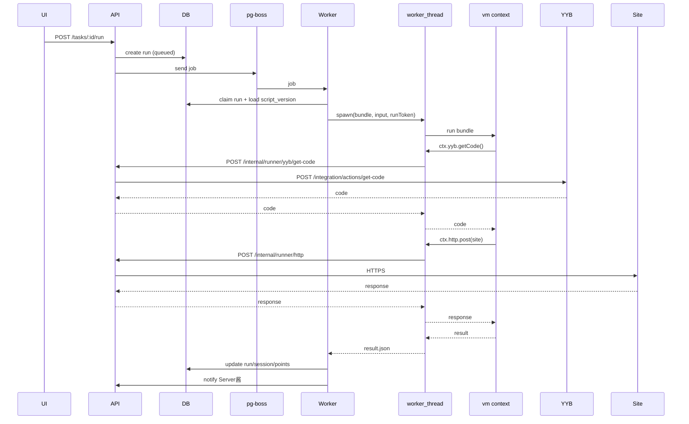

# 09 脚本运行时与订阅源

本文把 [05 脚本系统](05-script-system.md) 里的运行时/订阅部分展开成可实现的设计。目标是：**脚本可信、网络可控、运行可观测、更新可回滚**。

> 脚本按“一功能一脚本 + 公共模块”组织；一次 run 对应一个 action 脚本的 `capability`。公共模块不直接运行，详见 [11 脚本结构](11-script-structure.md)。

## 1. 执行模型

### 1.1 一次运行是什么

```text
一次 run = 一个 site_account + 一个 capability + 一个 script_version
```

- 平台按账号调度，不把多个账号塞进一个脚本。
- 同一 `site_account` 的写操作串行；不同账号可并发。
- 每次运行固定 `script_version_id`；运行中更新脚本不影响本次。
- 运行结束更新 session/积分/商品/活动/订单。

### 1.2 时序



## 2. 依赖与 Bundle 管线

### 2.1 依赖模型（类似青龙，但更可控）

脚本在 manifest 里声明依赖，平台统一安装/复用，不在每次运行时临时 `npm install`：

```json
{
  "dependencies": {
    "crypto-js": "4.2.0"
  }
}
```

平台按“依赖集合 hash”安装：

```text
deps_hash = sha256(sorted(name@version))
data/deps/<deps_hash>/
  package.json
  package-lock.json
  node_modules/
```

规则：

- 精确版本；安装后保存 lockfile，保证可复现。
- `npm install --omit=dev --ignore-scripts`（或 pnpm 同等配置），**禁止 postinstall/lifecycle scripts**。
- 多个脚本依赖集合相同时复用同一份 `node_modules`。
- 安装发生在脚本安装/更新时，不在每次 run。
- ARM64 上原生依赖可能编译失败；优先纯 JS 依赖，失败时脚本安装失败并显示日志。
- UI 可查看依赖集合、磁盘占用、清理未使用集合。
- 依赖也是代码，存在供应链风险；官方源由维护者审核，自定义源由用户自己判断。

### 2.2 Bundle

脚本代码用 esbuild 打包，但**依赖标记 external**，运行时通过受控 `require` 从依赖目录加载：

```bash
esbuild scripts/demo/adapter.ts \
  --bundle \
  --platform=node \
  --target=node22 \
  --format=cjs \
  --packages=external \
  --outfile=dist/demo/bundle.js \
  --sourcemap=external
```

约定：

- `@free-welfare/sdk` 打包进 bundle（自包含）。
- 第三方依赖不打包，走受控 `require`。
- bundle 大小上限（如 2MB）；source map 保留，方便排错。
- 不压缩（首期保留可读性）。

### 2.3 受控 require

vm 注入一个 `require(id)` 包装：

允许：

- manifest 里声明的依赖；
- 安全内置模块：`crypto`、`buffer`、`url`、`querystring`、`util`、`assert`、`events`、`stream`、`string_decoder`、`zlib`、`path`、`punycode`。

禁止：

- `fs`、`child_process`、`net`、`http`、`https`、`tls`、`dns`、`vm`、`worker_threads`、`cluster`、`module`、`os`。
- `process` 全局用最小 shim（`env: {}`、`platform`、`arch`、`version`、`nextTick`），不暴露 `binding`/`mainModule`。

边界：

- 直接 `require` 可以拦截；依赖内部的嵌套 `require` 由 Node loader 处理，无法完全拦截。
- 因此 **dependencies 只对官方 `reviewed` 脚本开放**；自定义源脚本不允许 dependencies/require，只能用 `ctx` API。需要依赖就提 PR 到官方源审核。

### 2.4 产物

```text
data/scripts/demo/0.1.0/
  bundle.js
  bundle.js.map
  manifest.json
  README.md
  bundle.sha256
```

DB `script_versions` 存 `bundle_path`、`bundle_hash`、`bundle_size`、`sdk_version`、`deps_hash`、`manifest`、`review_status`。

### 2.5 脚本放哪里：DB 还是文件系统

**推荐：DB 存元数据，文件系统存代码。**

| 内容 | 位置 |
| --- | --- |
| 脚本身份/版本/manifest/hash/review 状态/当前版本 | PostgreSQL |
| 应用内用户脚本（名称/简介/文件/参数/能力） | PostgreSQL `site_scripts` |
| 应用内脚本文件 | `data/apps/<siteKey>/scripts/` |
| 订阅版 `bundle.js` / source map / README | `data/scripts/<script>/<version>/` |
| 第三方依赖 `node_modules` | `data/deps/<depsHash>/` |
| 运行日志 | `data/logs/<runId>.log` |
| 截图/HAR/附件 | `data/artifacts/<runId>/` |

不把 JS 代码存 DB 的原因：

- 数据库备份会迅速膨胀；大字段影响迁移/恢复。
- Node/worker 需要文件路径/模块解析，文件系统更自然。
- 方便直接查看、debug、hash、回滚。
- 文件系统可以做原子 rename，DB 只存相对路径。

一致性流程：

```text
下载到 data/scripts/.tmp/<id>
  -> 校验 SHA-256
  -> 原子 rename 到 data/scripts/<script>/<version>/
  -> DB 插入/更新 script_version（bundle_path 相对路径）
  -> 切换 scripts.current_version_id
```

- DB 只存**相对路径**，不存绝对路径；防止路径穿越。
- 文件存在但 DB 没有：启动时清理或标记 orphan。
- DB 有但文件缺失：标记 `broken`，提示重新下载。
- 备份：DB + `data/scripts` + `data/deps`；脚本可从源重新下载，但版本要 pin。

Docker 里 `./data` 是持久化卷，重建容器不会丢脚本；不要把 `data/` 提交到 git。

## 3. VM 上下文

### 3.1 注入的全局

```ts
const context = vm.createContext({
  ctx,
  module: { exports: {} },
  exports: {},
  require: controlledRequire,
  Buffer,
  process: minimalProcessShim, // env:{}, platform, arch, version, nextTick
  console: restrictedConsole,
  URL,
  URLSearchParams,
  TextEncoder,
  TextDecoder,
  atob,
  btoa,
  crypto: webcrypto,       // Web Crypto；MD5 等用 ctx.crypto
  setTimeout: boundedTimeout,
  clearTimeout,
  setInterval: boundedInterval,
  clearInterval,
});
```

不注入：

- `process` 的真实对象、`fs`、`child_process`、`vm`
- `fetch`、`XMLHttpRequest`、`WebSocket`
- 宿主机环境变量
- 数据库/YYB token/其他账号 session

`require` 的边界见 2.3：官方脚本可按 manifest 加载依赖；自定义源脚本不允许 `require`。

### 3.2 逃逸问题

`vm` 不是安全边界：脚本可以通过原型链等方式尝试拿到 `process`。因此：

- **官方源只运行审核过的脚本；自定义源禁用 `dependencies/require`**；
- 不开放公开上传/任意代码；
- 未来要运行不可信脚本，换 Deno/容器/gVisor。

可以做的加固（不做过度承诺）：

- 不给 `process`/`require`；
- 限制 `setTimeout` 最大延迟；
- 冻结 `ctx` 对象；
- worker 以最小权限用户运行；
- Node `--experimental-permission`（可选）；
- 超时/内存/输出限制。

### 3.3 `ctx` API

```ts
interface Context {
  account: { id: number; name: string; yybRef: string };
  site: { id: number; key: string; name: string; appId: string };
  config: Record<string, unknown>;
  session: {
    get(key: string): unknown;
    set(key: string, value: unknown): void; // 本地更新，run 结束时落库
    delete(key: string): void;
  };
  yyb: {
    getCode(): Promise<string>;
    getPhoneNumber(): Promise<unknown>;
    operateWxData(payload: unknown): Promise<unknown>;
  };
  http: {
    get(url: string, options?: HttpOptions): Promise<HttpResponse>;
    post(url: string, options?: HttpOptions): Promise<HttpResponse>;
    request(method: string, url: string, options?: HttpOptions): Promise<HttpResponse>;
  };
  crypto: {
    md5(input: string | Uint8Array): string;
    sha1(input: string | Uint8Array): string;
    sha256(input: string | Uint8Array): string;
    hmac(alg: 'sha256' | 'sha1', key: string, data: string): string;
    aesEncrypt(...): string;
    aesDecrypt(...): string;
    base64Encode(input: string | Uint8Array): string;
    base64Decode(input: string): string;
  };
  log: {
    debug(message: string, data?: unknown): void;
    info(message: string, data?: unknown): void;
    warn(message: string, data?: unknown): void;
    error(message: string, data?: unknown): void;
  };
  sleep(ms: number): Promise<void>;
  time: { now(): Date; serverOffsetMs: number };
  runId: string;
  dryRun: boolean;
  businessError(code: string, message: string): Error;
  authExpired(message: string): Error;
  manualRequired(message: string): Error;
}
```

### 3.4 Session 语义

- 运行开始时，平台解密当前 `site_account.session_enc`，只把当前账号/站点的一份传给 worker。
- `ctx.session.set` 只更新 worker 本地副本并标脏。
- worker 在 `finally` 中把脏 session 写回平台；即使脚本抛错也会尝试写回。
- 写回走 `/internal/runner/session`，平台重新加密存储。
- 同一 `site_account` 串行运行，避免并发覆盖。
- 如果 worker 被超时强杀，未写回的 session 丢失；下次重新登录即可。

### 3.5 结果

```ts
interface RunResult {
  ok: boolean;
  capability: string;
  message: string;
  errorCode?: string;
  metrics?: {
    pointsBefore?: number;
    pointsAfter?: number;
    earned?: number;
    spent?: number;
  };
  data?: unknown;
  artifacts?: string[];
  nextActions?: string[];
}
```

worker 写 `result.json`；平台读取并更新 `runs.summary`。

## 4. HTTP 代理

### 4.1 请求

```ts
interface HttpOptions {
  headers?: Record<string, string>;
  json?: unknown;
  body?: string | Uint8Array;
  timeoutMs?: number;
  responseType?: 'json' | 'text';
  maxBytes?: number;
}

interface HttpResponse {
  status: number;
  headers: Record<string, string>;
  data?: unknown;   // responseType=json
  text?: string;    // responseType=text
  truncated?: boolean;
}
```

### 4.2 校验

先看应用级策略（[12 网络策略](12-network-policy.md)）：

- `network_mode=whitelist`：URL 必须在应用的 `allowed_origins` + 可选 `path_prefix` 内。
- `network_mode=unrestricted`：允许任意公网 http(s)，但仍拦截私网/回环/元数据/危险端口。
- 脚本 manifest 的 `allowed_domains` 是**缩小**声明：不能在应用白名单之外扩权。
- 有效策略 = 应用策略 ∩ 脚本声明。

其他：

- URL 必须 `https://`（本地测试可配置允许 http）。
- host 匹配精确域名；子域通配仅首期不支持（后续可加）。
- DNS 解析后拒绝：私网、回环、链路本地、组播、云元数据地址。
- 禁止非 80/443 端口（可配置）。
- 禁止/逐跳校验重定向，避免绕过白名单。
- 失败返回 `network_denied`，记录 URL/method/原因，不记录敏感 body。
- 限制 header 数量/大小、body 大小、响应大小。
- 超时默认 20s，最大 60s。
- 不自动重试 POST；GET/HEAD 可在网络错误时重试一次（由脚本或平台配置）。
- 记录审计：url/method/status/耗时；body/header 敏感值脱敏。

### 4.3 SSRF

首期做：

- host 白名单；
- 解析 IP 并拒绝私网/回环/元数据；
- 禁止重定向到非白名单域名（或直接禁止重定向）；
- 限制端口。

后续可加：

- 固定解析 IP（防 DNS rebinding）；
- 出站代理；
- 域名签名/allowlist 管理。

## 5. 并发与锁

### 5.1 账号串行

- `site_account_id` 作为 pg-boss `singletonKey` 的一部分，保证同一账号同站点不并发。
- 同一微信账号的 YYB `getCode` 再按 `wechat_account_id` 串行（进程内队列 + DB advisory lock）。
- 不同账号可并发，受全局 `WORKER_CONCURRENCY` 限制。

### 5.2 幂等

- 任务入队：`idempotency_key = task_id + scheduled_for`（签到按日期）。
- pg-boss `singletonKey` 防重复。
- 写操作前查状态；写后复查。
- 兑换/抢购单独幂等键。

### 5.3 重试

- 只有 `network_error`/`rate_limited`/`timeout` 才重试。
- 业务失败（已签到算成功、未注册、售罄、验证码）不重试。
- 重试次数/退避在 task 上配置；pg-boss 负责调度。
- 写操作“已提交未确认”标记 `unknown`，不自动重放。

## 6. 订阅源

### 6.1 `index.json`

```json
{
  "schema_version": 1,
  "generated_at": "2026-11-13T00:00:00Z",
  "scripts": [
    {
      "id": "demo.sign_in",
      "name": "每日签到",
      "version": "0.1.0",
      "description": "示例应用每日签到，获取积分",
      "kind": "action",
      "capability": "sign_in",
      "platform": "wechat_miniprogram",
      "app_id": "wx0000000000000000",
      "common_version": "0.1.0",
      "allowed_domains": ["api.example.com"],
      "review_status": "reviewed",
      "sdk_version": "0.1.0",
      "min_platform_version": "0.1.0",
      "bundle": {
        "url": "https://raw.githubusercontent.com/.../demo-0.1.0.js",
        "sha256": "...",
        "size": 12345
      },
      "changelog": "首个版本：登录 + 签到 + 积分"
    }
  ]
}
```

### 6.2 安装/更新

```text
同步 index
  -> 对比已安装版本
  -> 显示可用更新/changelog
  -> 下载 bundle
  -> 校验 sha256 + size
  -> 写入 script_version
  -> 原子切换 current_version
  -> 旧版本保留，可回滚
```

### 6.3 版本固定

- `tasks` 不直接绑定版本；运行时取 `scripts.current_version_id`。
- `runs.script_version_id` 固定，历史可追溯。
- 更新后可选择“只影响新运行”，进行中的 run 不受影响。
- 回滚只切换指针，不删除旧 bundle。

### 6.4 审核

脚本仓库 CI：

- manifest JSON Schema + dependencies 精确版本；
- `tsc --noEmit`；
- 单测；
- esbuild 构建；
- 依赖安装用 `--ignore-scripts`，检查 lockfile；
- 扫描禁止项：`fs`、`child_process`、`net`、`http`、`https`、`tls`、`dns`、`vm`、硬编码 token/手机号；
- 计算 hash/size；
- 生成 index。

维护者审核：

- 接口来源是否可信；
- 依赖是否必要、是否可信、是否有 postinstall；
- 是否只访问 `allowed_domains`；
- 是否幂等/失败处理；
- 是否泄露敏感信息；
- 是否有测试/脱敏 fixture。

### 6.5 信任等级

| 状态 | 来源 | 运行时限制 | UI |
| --- | --- | --- | --- |
| `reviewed` | 官方源，审核通过 | 可用 dependencies/require | 默认显示 |
| `community` | 社区源，未完全审核 | 可用 dependencies/require，但需确认 | 需确认 |
| `custom` | 用户自定义源 | **不允许 dependencies/require**，只能用 `ctx` API | 强警告 |

自定义源规则：

- 用户自己填 GitHub 源，自己判断风险。
- 首期自定义脚本不允许 `dependencies`/`require`，只能走 `ctx.yyb`/`ctx.http`/`ctx.session`，降低读取本机文件/环境变量的风险。
- 需要依赖的脚本，提交 PR 到官方源审核。
- 自定义源默认 `update_policy=manual`，不自动更新。

### 6.6 更新策略

每个脚本可配置：

- `manual`：默认，显示 changelog/权限变化，用户确认后更新。
- `auto`：只允许 `reviewed` 脚本自动更新；`custom` 强制 manual。

更新只影响新 run；进行中的 run 固定旧 `script_version_id`。

## 7. 安全清单

- [ ] 官方源脚本才允许 dependencies/require；自定义源只能用 ctx API。
- [ ] 安装/更新校验 SHA-256 + size。
- [ ] 依赖在安装时统一安装，`--ignore-scripts`；不在每次 run 安装。
- [ ] 不注入真实 `process/fs`；`require` 受控；custom 禁用 `require`。
- [ ] HTTP 走代理，域名白名单 + 私网拦截。
- [ ] YYB 只允许当前账号/站点。
- [ ] session 只给当前 site_account。
- [ ] 日志脱敏 code/sid/token/cookie/phone/openid。
- [ ] worker 超时/内存/输出限制。
- [ ] 同账号串行，防并发覆盖。
- [ ] 脚本版本/hash 与 run 关联。
- [ ] 备份 DB + data/。

## 8. 测试与 dry-run

### 8.1 脚本侧

- 纯函数单测（如 `interpretSignResult`）。
- mock `ctx` 的契约测试。
- fixture：脱敏请求/响应。
- `ctx.dryRun`：写操作前直接返回，不提交。

### 8.2 平台侧

- 安装脚本 → 绑定 → 手动 run。
- 重复 run 不重复签到。
- 超时/崩溃能回收 worker。
- 日志/结果/错误码正确。
- 更新/回滚后旧 run 可查。
- HTTP 代理拦截非白名单域名。
- 私网 URL 被拒绝。

## 9. 已确定与待确认

### 已确定

- **依赖**：manifest 声明 `dependencies`；平台统一安装/复用依赖集合；官方源脚本可用，自定义源不允许。
- **自定义源**：支持；强警告；用户自己判断风险；custom 脚本只能用 `ctx` API，不允许 `dependencies/require`（已确认接受）。
- **index 签名**：不做；依赖 HTTPS + GitHub + SHA-256 + 审核。
- **更新策略**：按脚本配置 `manual`/`auto`；`custom` 强制 `manual`。

### 默认决定

- **source map**：保留，运行详情可查看；单用户部署无泄露问题。
- **dry-run**：登录可执行，签到/兑换/抢购跳过写操作。
- **community 层**：枚举保留，首期 UI 默认只显示 `reviewed` + `custom`。

### 无阻塞项

脚本运行时/订阅源的设计可以进入实现；后续如果允许 custom 使用依赖，需要先做 Deno/容器隔离。
